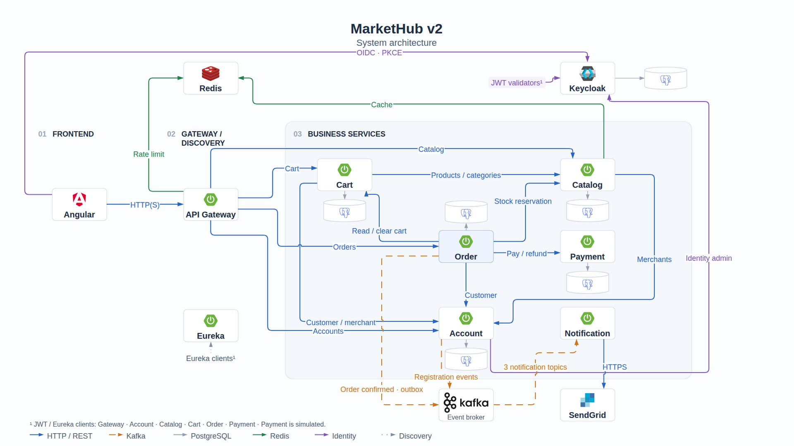
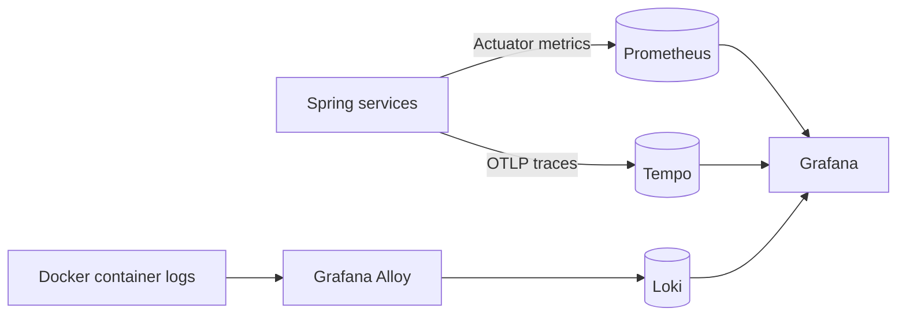
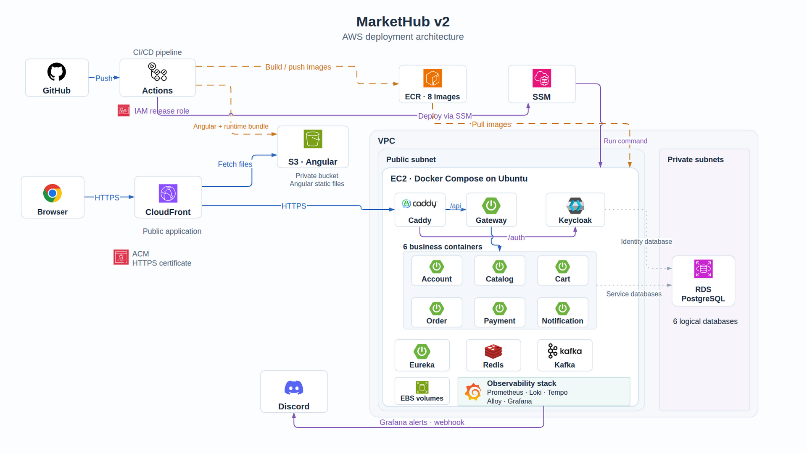

<div align="center">

# MarketHub v2

### A distributed marketplace platform built with Java and Spring

[](https://openjdk.org/)
[](https://spring.io/projects/spring-boot)
[](https://www.postgresql.org/)
[](https://kafka.apache.org/)
[](https://www.docker.com/)
[](https://github.com/tuiop1/MarketHub-v2/actions/workflows/testandbuild.yml)

**MarketHub v2** is a distributed marketplace platform that supports customer, merchant, and administrative workflows across independently deployable services. It provides secure authentication and role management, product and category management, cart operations, stock reservation, coordinated order and payment processing, failure compensation, asynchronous email notifications, observability, and automated deployment.

[Live application](https://markethub-prod.xyz) · [Architecture](#architecture) · [API](#api-endpoints) · [Order Flow](#order-and-payment-flow) · [Run Locally](#running-locally) · [Deployment](#production-deployment)

</div>

---

## Project walkthrough

[](https://youtu.be/uVznAtdxkjA)

---

## Overview

MarketHub supports the principal marketplace flows end to end:

- customers can register, browse products, manage a cart, and place orders;
- merchants can register, pass an approval workflow, and manage their products;
- administrators can manage merchant applications, customers, and categories;
- stock is reserved before payment and finalized only after a successful purchase;
- payment or downstream failures trigger refund/cancellation and stock-release compensation;
- registration and order-confirmation emails are processed asynchronously;
- metrics, logs, and traces can be inspected through an optional observability stack.

## Engineering highlights

- Eight Spring services organized around business and infrastructure responsibilities.
- Orchestrated purchase saga with explicit stock reservation and compensation.
- Keycloak-based OAuth 2.0/OpenID Connect authentication and role-based authorization.
- REST communication for immediate operations and Kafka events for asynchronous notifications.
- Separate logical database ownership for every stateful business service.
- Redis-backed gateway rate limiting and catalog caching.
- Eureka-based service discovery.
- Prometheus, Grafana, Loki, Tempo, Alloy, Micrometer, and OpenTelemetry integration.
- Docker Compose environments for local development and production deployment.
- GitHub Actions for testing, immutable ECR image builds, and AWS releases through OIDC and Systems Manager.

---

## Architecture

MarketHub is divided into an edge layer, domain services, platform services, and supporting infrastructure. In AWS, CloudFront serves the Angular application from private S3 and routes API requests through Caddy on EC2 to the API Gateway. The gateway validates JWTs, applies Redis-backed rate limits, and forwards only public API routes. Keycloak owns identities and realm roles, while Eureka allows services to resolve each other without hard-coded addresses.

The business logic is split by capability rather than by technical layer. Account, catalog, cart, order, and payment data remain under the ownership of their respective services. In AWS, five domain databases and the Keycloak database share one private RDS PostgreSQL instance, with separate database roles. Local development uses a PostgreSQL container.

Immediate operations use synchronous REST calls because the caller needs a result before continuing. Kafka is used for customer registration, merchant registration, and order-confirmation events because notification delivery should not extend or block the main transaction.



### Service boundaries

| Service | Port | Responsibility | State |
|---|---:|---|---|
| `gateway-service` | `8080` | API routing, JWT validation, and rate limiting | Redis |
| `account-service` | `8081` | Customer and merchant accounts, approval workflow, Keycloak administration | `account` database |
| `catalog-service` | `8082` | Categories, products, merchant catalog, and stock reservations | `catalog` database + Redis |
| `order-service` | `8083` | Orders, item snapshots, and purchase-saga orchestration | `orders` database |
| `cart-service` | `8084` | Customer carts and cart items | `cart` database |
| `payment-service` | `8085` | Payment lifecycle and refund/cancellation compensation | `payment` database |
| `notification-service` | `8086` | Kafka consumers and SendGrid email delivery | Stateless |
| `discovery-service` | `8761` | Eureka service registry | Stateless |

Application-service ports are internal to the Docker network. Payment, notification, discovery, and stock-reservation operations are intentionally not exposed as general public gateway routes.

---

## API endpoints

The external API is versioned under `/api/v1` and is accessed through the API Gateway. Protected endpoints expect a Keycloak bearer token:

```http
Authorization: Bearer <access-token>
```

### Main endpoint groups

| Area | Representative endpoints | Access |
|---|---|---|
| Registration | `POST /api/v1/auth/customers/register`<br>`POST /api/v1/auth/merchants/register` | Public |
| Public catalog | `GET /api/v1/products`<br>`GET /api/v1/products/{productId}`<br>`GET /api/v1/categories` | Public |
| Merchants | `GET /api/v1/merchants`<br>`GET /api/v1/merchants/{merchantId}`<br>`GET /api/v1/merchants/me` | Public / authenticated merchant |
| Customer account | `GET /api/v1/customers/me` | Customer |
| Cart | `GET /api/v1/carts`<br>`POST /api/v1/carts/items`<br>`DELETE /api/v1/carts/items/{itemId}`<br>`DELETE /api/v1/carts/items` | Authenticated customer |
| Orders | `POST /api/v1/orders/purchase`<br>`POST /api/v1/orders/my-cart/purchase`<br>`GET /api/v1/orders/me` | Customer |
| Merchant products | `GET /api/v1/merchant/products`<br>`POST /api/v1/merchant/products`<br>`PUT /api/v1/merchant/products/{productId}`<br>`DELETE /api/v1/merchant/products/{productId}` | Merchant |
| Administration | `/api/v1/admin/merchants/**`<br>`/api/v1/admin/customers/**`<br>`/api/v1/admin/categories/**` | Admin |

Collection endpoints support Spring pagination parameters where applicable:

```text
?page=0&size=20&sort=createdAt,desc
```

The table presents the main public contract rather than every controller method. Internal service endpoints are used only for service-to-service operations such as customer lookup, stock reservation, payment execution, and compensation.

---

## Order and payment flow

`order-service` acts as the saga orchestrator. It coordinates account, catalog, payment, and notification responsibilities without sharing their databases or attempting a distributed database transaction.

### Successful purchase

1. The authenticated customer submits a direct purchase request or purchases the current cart.
2. `order-service` loads the customer data required for the order snapshot.
3. `catalog-service` validates the requested products and creates a stock reservation.
4. The order is persisted with immutable product-name and price snapshots in `PENDING_PAYMENT` state.
5. `payment-service` creates and processes the payment.
6. When payment succeeds, the stock reservation is committed and the order becomes paid.
7. An order-confirmation record is saved through a transactional outbox; its publisher delivers `OrderConfirmedEvent` to Kafka, where it is consumed by `notification-service`, which sends the confirmation email independently of the HTTP request.

Payment processing is simulated: card and Google Pay succeed, while QR payment fails to demonstrate compensation. No real payment provider is connected.

### Failure and compensation

A rejected payment releases the stock reservation and records the failed order state. If an unexpected error occurs after payment or stock work has already started, the orchestrator attempts the required compensating actions: payment cancellation or refund, followed by stock release. Compensation failure is stored explicitly instead of being hidden, making incomplete recovery visible for investigation.

This design keeps each service responsible for its own state while giving the purchase workflow a clear place for coordination and failure handling.

---

## Architectural approach

**Clear data ownership.** Each stateful domain service owns its schema and persistence logic. No service reads another service's tables directly, so integration happens through defined HTTP or event contracts.

**Consistency without distributed transactions.** The purchase flow uses reservation and compensation instead of a transaction spanning several databases. This increases workflow complexity, but it makes partial failures explicit and preserves service autonomy.

**Different communication styles for different requirements.** REST is used when the next step depends on an immediate response. Kafka is reserved for asynchronous side effects, primarily notification delivery, where temporary consumer unavailability should not invalidate the completed business operation.

**Security at more than one layer.** The gateway validates incoming tokens and downstream protected services also operate as OAuth 2.0 resource servers. Administrative identity operations are isolated in `account-service` through a confidential Keycloak service account.

**Production-oriented deployment with controlled infrastructure costs.** The AWS deployment uses one EC2 Docker Compose host, one Kafka broker, and one private RDS PostgreSQL instance to control cost and resource usage. CloudFront and S3 serve the frontend independently of the backend host. Logical service separation, health checks, persistent volumes, observability, and automated deployment are retained while keeping the operational footprint manageable.

---

## Identity and authorization

- Keycloak provides OpenID Connect authentication and issues JWT access tokens.
- The gateway and protected services validate signed tokens as OAuth 2.0 resource servers.
- The frontend uses a public Keycloak client with Authorization Code flow and PKCE for interactive login.
- `account-service` uses a confidential service account to create users, assign roles, and manage account state.
- Merchant privileges are granted only after administrative approval.
- Platform roles include `ADMIN`, `CUSTOMER`, `MERCHANT_PENDING`, `MERCHANT`, and `MERCHANT_REJECTED`.
- Production secrets are supplied through environment variables and are not committed to the repository.

---

## Event-driven notifications

`common-events` contains shared Kafka contracts including:

- `CustomerRegisteredEvent`
- `MerchantRegisteredEvent`
- `OrderConfirmedEvent`
- `OrderConfirmedItemSnapshot`

Account and order services publish these events. `notification-service` consumes them in its own consumer group and sends email through SendGrid. Notification latency and availability therefore do not extend the primary user-facing transaction.

---

## Observability

The `observability` Compose profile provides metrics, centralized logs, and distributed traces. It is optional locally and enabled by the AWS release script.



| Signal | Pipeline |
|---|---|
| Metrics | Spring Boot Actuator → Prometheus → Grafana |
| Logs | Structured container logs → Alloy → Loki → Grafana |
| Traces | OpenTelemetry OTLP export → Tempo → Grafana |

Tracing is controlled through `OTLP_TRACING_ENABLED`: disabled by default locally and enabled by default in AWS with a 0.1 sampling probability. Alloy collects Docker logs; Spring services export traces directly to Tempo. Grafana sends alert notifications to Discord through a webhook. In AWS, Grafana binds only to host loopback (`127.0.0.1:3001`) for administrative tunnel access. Prometheus, Loki and Tempo use short retention windows for this demo deployment.

---

## Technology stack

**Backend:** Java 25, Spring Boot 4.1, Spring Cloud, Spring MVC, Spring Cloud Gateway, Spring Security, Spring Data JPA, Hibernate, Spring Kafka, Actuator, Micrometer, OpenTelemetry, Maven, MapStruct, Lombok.

**Data and infrastructure:** PostgreSQL 16, Liquibase, Redis, Apache Kafka in KRaft mode, Keycloak, Eureka, SendGrid, Docker Compose, Nginx, and Caddy.

**Observability and delivery:** Prometheus, Grafana, Loki, Tempo, Grafana Alloy, GitHub Actions, Amazon ECR, S3, CloudFront, ACM, EC2, RDS, IAM OIDC, and Systems Manager Run Command.

**Testing:** JUnit 5, Mockito, Spring Boot test support, Testcontainers, repository tests, and integration tests for stateful workflows.

---

## Repository structure

```text
MarketHub-v2/
├── .github/workflows/
│   ├── testandbuild.yml
│   ├── deployaws.yml          # current AWS release
│   └── deployproduction.yml   # original VPS release
├── backend/
│   ├── libs/
│   │   ├── common-api/
│   │   └── common-events/
│   └── services/
│       ├── account-service/
│       ├── cart-service/
│       ├── catalog-service/
│       ├── discovery-service/
│       ├── gateway-service/
│       ├── notification-service/
│       ├── order-service/
│       └── payment-service/
├── docker/
│   ├── keycloak/
│   └── postgres/
├── frontend/
├── docs/architecture/        # system and AWS deployment diagrams
├── observability/
├── .env.prod.example
├── docker-compose.yml
└── production/
    ├── ec2/     # original single-server deployment
    └── aws/     # EC2 + RDS + S3/CloudFront deployment
```

`common-api` contains deliberately shared API contracts. `common-events` contains Kafka event contracts used across service boundaries.

---

## Running locally

### Prerequisites

- Docker with Docker Compose
- JDK 25
- Git

### Start the project

```bash
git clone https://github.com/tuiop1/MarketHub-v2.git
cd MarketHub-v2

export KEYCLOAK_ADMIN_CLIENT_SECRET="replace-with-a-long-random-local-secret"
docker compose up -d --build
```

Optional email configuration:

```bash
export SENDGRID_API_KEY="your-api-key"
export SENDGRID_FROM_EMAIL="verified-sender@example.com"
export SENDGRID_FROM_NAME="MarketHub"
```

Without valid SendGrid credentials, the platform can still run, but real email delivery is unavailable.

### Local URLs

| Component | URL |
|---|---|
| Application | `http://localhost:3000` |
| Keycloak | `http://localhost:8090` |
| Grafana with observability enabled | `http://localhost:3001` |

The local Keycloak bootstrap administrator is `admin` / `admin` and is intended only for development.

### Run backend verification

```bash
cd backend
./mvnw --batch-mode --no-transfer-progress clean verify
```

### Start the observability profile

```bash
export OTLP_TRACING_ENABLED=true
docker compose --profile observability up -d --build
```

### Inspect or stop the stack

```bash
docker compose ps
docker compose logs -f gateway-service order-service payment-service
docker compose down
```

Use `docker compose down -v` only when the persistent local data should also be deleted.

---

## CI/CD

[Deploy to AWS](.github/workflows/deployaws.yml) runs on pushes to `main` and can also be dispatched manually from `main`.

1. **Verify:** reuse [Test and build](.github/workflows/testandbuild.yml) for Maven verification, Angular tests and a production build, Compose validation, and deployment-script checks.
2. **Publish images:** obtain temporary AWS credentials through GitHub OIDC and an IAM release role. Build eight Spring service images for `linux/amd64` and push them to ECR, tagged with the full commit SHA. Existing SHA images are reused.
3. **Release backend:** upload an allowlisted runtime archive to private S3, then invoke EC2 through SSM Run Command. The instance role downloads the archive and pulls ECR images; no inbound SSH connection from GitHub is required.
4. **Check and promote:** start Compose with observability, check health, restart stability, Tempo readiness, and public API/auth responses, then update the current/previous release pointers.
5. **Publish frontend:** after backend success, upload the tested Angular assets to S3, write `index.html` last, invalidate CloudFront, and probe the application, SPA routing, API, and identity endpoints.

Backend rollout failures restore the previous containers and configuration. Database migrations are not reversed, and frontend publication failures do not automatically roll back the backend. This single-host rollout does not guarantee zero downtime.

The workflow uses repository variables `AWS_REGION`, `AWS_ACCOUNT_ID`, `AWS_DEPLOY_ROLE_ARN`, `EC2_INSTANCE_ID`, `FRONTEND_BUCKET`, `CLOUDFRONT_DISTRIBUTION_ID`, and `PUBLIC_APP_URL`. Runtime secrets remain in the protected environment file on EC2; GitHub uses temporary AWS credentials rather than stored AWS access keys.

---

## Production deployment

The current application is deployed at **[markethub-prod.xyz](https://markethub-prod.xyz)**. AWS runtime configuration lives in [`production/aws`](production/aws/). The original single-server deployment remains under [`production/ec2`](production/ec2/README.md).



### AWS resources and responsibilities

| Resource | Role |
|---|---|
| **CloudFront** | Public HTTPS entry point; serves Angular from S3 and forwards uncached `/api` and `/auth` requests to the EC2 origin |
| **S3** | Private Angular static files via Origin Access Control; a separate `releases/<SHA>/` prefix holds runtime archives and is blocked from public CDN requests |
| **ACM** | CloudFront viewer TLS certificate in `us-east-1`; application resources are in Frankfurt (`eu-central-1`) |
| **EC2** | One Ubuntu host running Docker Compose: eight Spring services, Caddy, Keycloak, Kafka, Redis, and five observability containers |
| **ECR** | Eight service image repositories with full commit-SHA release tags; images are built in CI rather than on EC2 |
| **RDS PostgreSQL** | One private database instance containing `account`, `catalog`, `cart`, `orders`, `payment`, and `keycloak`, each with its own role |
| **VPC and security groups** | EC2 in a public subnet; RDS in private subnets, with database access restricted to the EC2 security group |
| **IAM and Systems Manager** | GitHub OIDC release role, EC2 runtime role, and SSM Run Command for deployment |
| **EBS / Docker volumes** | Persistent broker, cache, Caddy, and telemetry data across container recreation |

The AWS stack runs 17 long-lived containers with observability enabled. Angular runs in the browser; neither a frontend server nor PostgreSQL runs as a production EC2 container. Kafka, Redis, Eureka, and business services communicate over the private Docker network.

### Request routing and TLS

- Browser → **CloudFront** over HTTPS.
- Static files → **private S3**; a CloudFront Function rewrites frontend navigation routes to `index.html`.
- `/api/*` → **HTTPS Caddy origin** → **Gateway** → business services.
- `/auth/*` → **HTTPS Caddy origin** → **Keycloak**, preserving the public OIDC issuer.
- Services and Keycloak → **private RDS** using TLS with certificate verification.

CloudFront uses an ACM viewer certificate; Caddy manages the origin certificate. Caddy checks a shared origin header before proxying and supplies the public forwarded host. API and authentication responses are not cached. Container ports remain internal, apart from Caddy's public entry points and Grafana's loopback binding.

### Setup and operations

AWS resources must exist before releasing; the workflow deploys the application into existing infrastructure. Use the [runtime configuration example](production/aws/.env.example), [IAM policies](production/aws/iam/), and [database bootstrap](production/aws/rds/) when configuring the environment. The executable [release workflow](.github/workflows/deployaws.yml) and [deployment script](production/aws/deploy.sh) define the current automated release behavior.

Validate the runtime configuration using example values without contacting AWS:

```bash
AWS_ENV_FILE="$PWD/production/aws/.env.example" \
  bash production/aws/compose.sh --profile observability config --quiet
```

On EC2, inspect the active release with its shared environment file and release tag:

```bash
cd /opt/markethub/current
export AWS_ENV_FILE=/opt/MarketHub-v2/production/aws/.env
bash production/aws/compose.sh --profile observability ps
bash production/aws/compose.sh --profile observability logs -f gateway-service order-service
```

This is a compact demo deployment with a single backend host and broker. It demonstrates service isolation and managed database/static delivery, while retaining a small operational footprint.

---

## Frontend

The included Angular frontend was **AI-generated** and integrated as a functional web client for the platform. It provides access to the main customer, merchant, and administrative workflows and allows the complete system to be demonstrated end to end.

The Java backend implements the platform's service decomposition, domain workflows, data consistency mechanisms, security, messaging, testing, deployment, and observability.

---

## Author

Developed by **[tuiop1](https://github.com/tuiop1)**.
